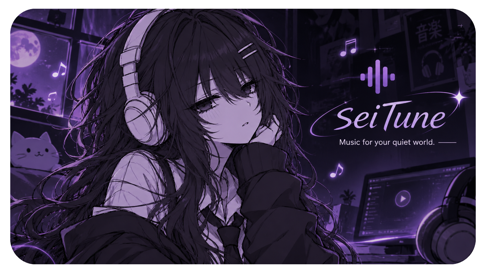

<div align="center">



**Music for your quiet world.**

A free, ad-free music and video player for Android that searches YouTube, streams the media file itself, and downloads songs and videos to your device. Everything runs inside the app: no account and no API key.

[](https://www.gnu.org/licenses/gpl-3.0)


</div>

## Features

### Play
- Search songs, videos and artists, with a home feed of recommended, trending and anime music, plus chips for Music, Mixes, Anime, Chill and Live.
- Streams the media file directly, so there are no ads.
- Tap a thumbnail to open an expanded, YouTube-style video player with a loading screen. Tap the title to play audio only.
- Audio / Video switch keeps the same track and position.
- Background play with a media notification and lock-screen controls. Music keeps playing with the screen off, in other apps, or after you press Back. If you leave the app while a video plays, it carries on as audio at the same spot.
- Queue, shuffle, repeat (off / all / one), favourites and recently played.
- Playlists: search YouTube playlists, open them, or paste a playlist link.

### Download
- Audio (M4A, no conversion) or video (MP4, 360p to 1080p).
- Fast downloads: the stream link is fetched directly and downloaded in parallel pieces, with yt-dlp as the fallback.
- Download everything from a search or a playlist in one tap. Items queue and run 1 to 6 at a time.
- Saved to `/storage/emulated/0/Music/SeiTune/` by default, so songs show up in your music apps but not in Gallery. Change the folder in **Settings > Save folder**.
- Playlist downloads go into a sub-folder named after the playlist.
- Video is saved to the matching `Movies` folder, because Android does not allow video inside `Music`.

### Offline
- **Cache priority** for playback: download, then cache, then stream.
- **Auto-cache** keeps the songs you stream, within a size limit of 256 MB to 5 GB or unlimited. Pin items to keep them, or clear the rest. Optional Wi-Fi only caching.
- When YouTube cannot be reached, Home and Search show what is saved on the device.
- **Import a music folder** from phone storage or an SD card. Nothing is copied and your files are never changed. Title, artist and length are read from the tags.

### Interface
- Dark and light themes.
- Android Back button goes back one level: closes sheets, collapses the player, leaves a playlist, returns to Home, and only then sends the app to the background.

## Performance

Measured on a rooted device with the screen off. **This test is only for offline play** (playing saved songs).

```text
====================================================================
 BACKGROUND CPU WASTE, GAMING IMPACT & BATTERY PREDICTION REPORT
====================================================================
Note              : ROOTED DEVICE CHECKS (su / kernel /proc access)
Date & Time       : 2026-11-13 16:16:22
Target Package    : com.mrk.seitune (PID: 24841)
Sample Duration   : 60 seconds (20 samples)
Battery Capacity  : 7000 mAh
 TRUE LIVE CPU METRICS (BACKGROUND)
--------------------------------------------------------------------
Average Live CPU  : 0.00%
Peak CPU Spike    : 0%
Big Core Hits     : 8 / 20 samples (Cores 4-7)
 DEEP MEMORY FOOTPRINT (DUMPSYS MEMINFO)
--------------------------------------------------------------------
True Private PSS  : 121.5 MB (124428 KB)
Total Shared RSS  : 263.7 MB (269992 KB)
Graphics Textures : 41.1 MB (42060 KB)
 GAMING PERFORMANCE IMPACT
--------------------------------------------------------------------
Verdict           : EXCELLENT (Zero Lag / Safe for Competitive Gaming)
Voluntary Wakeups : 0.6 wakeups/sec (Audio buffer feeding)
Forced Preempts   : 1 total (CPU thread contention)
 PREDICTED BACKGROUND BATTERY DRAIN (SCREEN OFF)
--------------------------------------------------------------------
Estimated Power   : ~40.0 mAh / hour
Estimated Drain   : ~0.57% battery / hour
10-Hour Playback  : ~5.7% total battery used
====================================================================
Note: Generated via Root (su) kernel profiling on Android.
====================================================================
```

## Install

Download the latest APK from the [Releases](https://github.com/glmrkk09/SeiTune/releases) page, or build it yourself (below). Allow installs from unknown sources when Android asks.

Requirements: Android 7.0 (API 24) or newer, 64-bit ARM (arm64-v8a) phone.

## Build

**Android Studio:** File > Open this folder, let Gradle sync, then Build > Build APK(s).

**Terminal** (JDK 17 and Gradle 8.9+):

```bash
gradle assembleRelease
```

The APK is written to `app/build/outputs/apk/release/app-release.apk`. Use `assembleDebug` for a debug build.

**GitHub Actions, no PC setup:** push the project to a repository, open the **Actions** tab, run **Build APK**, then download the `SEITUNE-apk` artifact.

## How it works

| Part | Role |
|---|---|
| `MainActivity` | The app's own browser: a WebView showing `assets/index.html` |
| `Api.kt` | Answers the UI's `/api/...` calls inside the app, with no network port |
| `PlaybackService` | Foreground service with a native audio player, notification and lock-screen controls |
| `Offline.kt` | Downloads, cache, priorities, pinning and cleanup |
| `MusicFolders.kt` | Imported music folders |
| `SaveDir.kt` | Public save folder (MediaStore) |
| [youtubedl-android](https://github.com/yausername/youtubedl-android) | Bundles Python and yt-dlp; yt-dlp updates itself in the background |

The user interface is a single self-contained HTML file with no outside libraries, frameworks or CDNs. Thumbnails load from `i.ytimg.com`.

ffmpeg is not bundled, to keep the APK small. As a result there is no MP3 conversion, and video is limited to single-file formats (usually 360p for streaming and downloads).

## Privacy

SeiTune has no account, analytics or tracking. Nothing is sent anywhere except the requests you trigger to the sites you search, stream and download from. Downloads and the cache are stored on your device. Imported folders are only read.

## Disclaimer

SeiTune is a general-purpose player and download client. It hosts no content, and everything you search, play or download comes straight from third-party services to your device. You alone are responsible for your use of the app, for following the laws that apply to you, the rights of creators and the terms of the services you use. Only download content you have the right to download. The developer does not condone illegal use and is not liable for any use or misuse of the app. Read the full [DISCLAIMER](DISCLAIMER.md).

## License

Copyright (C) 2026 Glmrk.

SeiTune is free software under the **GNU General Public License v3**: you can use, study, change and share it, and any copy or changed version must stay free under the same license with the source code available. See [LICENSE](LICENSE) (and the [DISCLAIMER](DISCLAIMER.md)) or <https://www.gnu.org/licenses/gpl-3.0.html>.

Third-party: [yt-dlp](https://github.com/yt-dlp/yt-dlp) (Unlicense), [youtubedl-android](https://github.com/yausername/youtubedl-android) (GPL v3).
